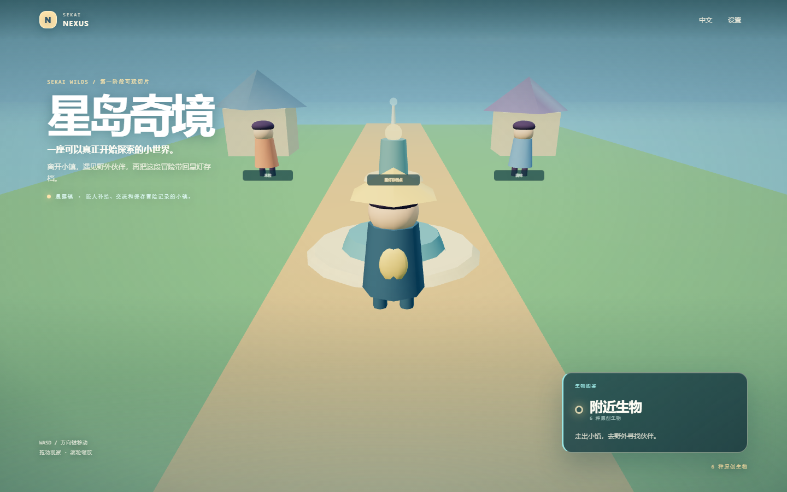
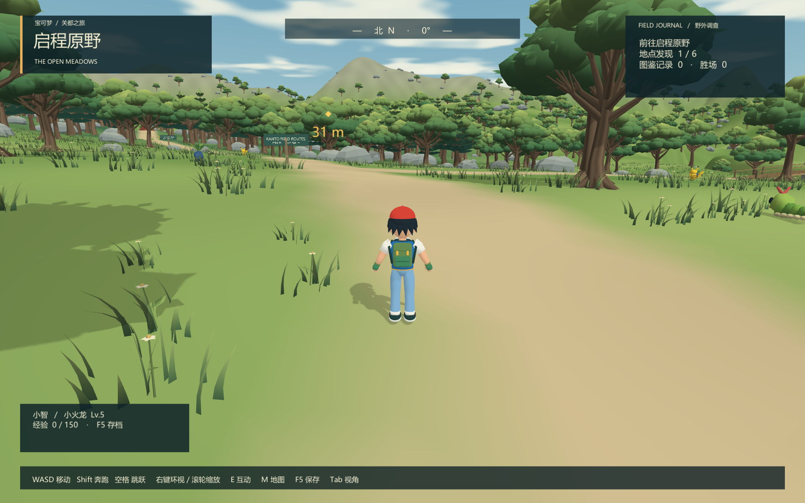
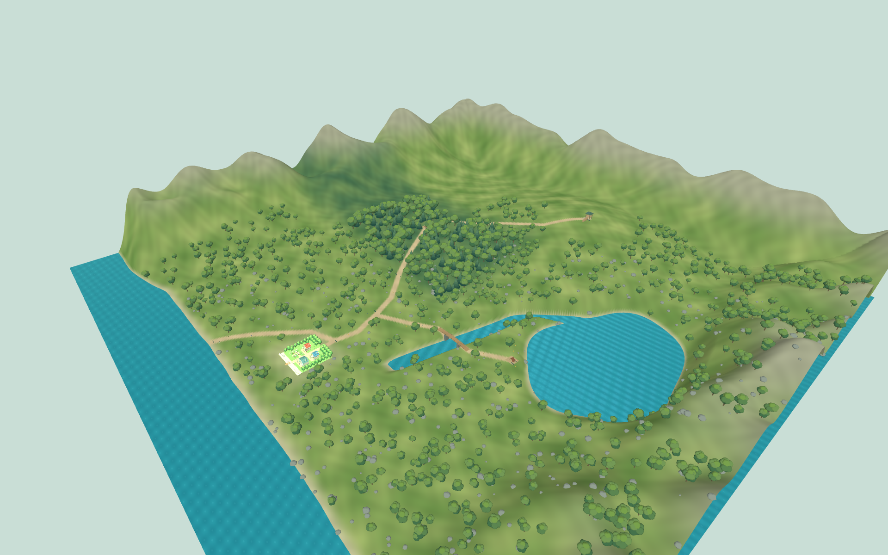

<div align="center">

# 🌌 Sekai World Engine & Nexus · 世界引擎与记忆回廊

**Sekai 系列实战项目 15/15 · 世界模拟、3D 原型与系列总入口**

[](https://spring.io)
[](https://vuejs.org)
[](https://unity.com)
[](https://openjdk.org)
[](https://github.com/sekai-lyr/sekai-product)



<sub>▲ Sekai Nexus 记忆回廊 —— 走进任意一扇门，就进入一个完整的项目世界</sub>

</div>

---

## 🏛️ 三个核心组成

### 1. Sekai Nexus · 记忆回廊（系列总入口）

一个 Fantasy 风格的 Web 大厅，把 Sekai 系列的 14 个项目世界收纳为 14 扇门：
选择 → 镜头推进 → 门开启 → 光晕绽放，**进入一个世界是一种仪式，而不是一次点击**。
Web 世界直接对接 `localhost:8081…8094` 的真实本地服务；Godot / Ren'Py / 桌面项目则直达其源码目录。

- 📂 `sekai-nexus/`（Web，含 dist 可直接预览）

### 2. Sekai World Engine · 确定性世界引擎（MVP）

以 **"可解释、可回放、可分支"** 为核心的原创虚拟世界引擎：

- 👤 用户注册登录、创建种子世界（1 城市 / 5 地点 / 3 阵营 / 12 角色）
- 📜 规则与事件模板、按日推进、事件选择、时间线
- 🌿 快照、**分支复制与分支对比**（世界并行演化）
- 🖥️ Vue 3 + TypeScript 世界控制台

```text
backend/    Java 21 · Spring Boot 4 · Spring MVC · MyBatis · Flyway
frontend/   Vue 3 · TypeScript · Vite · Vue Router
database/   MySQL 8 初始化与种子脚本
docs/       蓝图 · 领域模型 · API 草案 · ADR
```

- 📂 `sekai-world-engine/`

### 3. 游戏原型实验场

围绕"如何用引擎思维做游戏"的一系列原型迭代，每个原型都带截图评审记录（`*-review/`）：

| 原型 | 内容 |
|------|------|
| `battle-3d` | 3D 回合战斗（草地/森林/湖泊/山脊多场景） |
| `open-world` | 3D 开放世界探索（含野外生物生态） |
| `pallet-town` | 真新镇风格的 2D 小镇漫游 |
| `ash-player` / `unity-2d` / `model-depth` | 角色扮演、2D 精灵渲染与模型深度实验 |

<div align="center">

<br/>
<sub>左：3D 回合战斗 · 右：开放世界全景</sub>
</div>

---

## 🚀 快速开始

```bash
# World Engine 后端
cd memory-15/sekai-world-engine/backend
./mvnw spring-boot:run

# World Engine 前端
cd ../frontend
npm install && npm run dev

# Nexus 记忆回廊（静态页可直接打开）
open memory-15/sekai-nexus/dist/index.html
```

---

## 🗺️ Sekai 项目全景导航

| # | 项目 | 一句话 | 目录 |
|---|------|--------|------|
| 1 | Sekai Data Object | 二次元数据中心 | [memory-1](../memory-1/) |
| 2 | Sekai eBusiness | 二次元电商商城 | [memory-2](../memory-2/) |
| 3 | Sekai Memory Book | 二次元回忆录 | [memory-3](../memory-3/) |
| 4 | Sekai Fortune | 角色抽签与今日运势 | [memory-4](../memory-4/) |
| 5 | Sekai Song Player | 歌词同步音乐播放器 | [memory-5](../memory-5/) |
| 6 | Sekai 2048 | 原创角色合成小游戏 | [memory-6](../memory-6/) |
| 7 | Sekai Picture | 二次元壁纸图库系统 | [memory-7](../memory-7/) |
| 8 | English Word Learning | 英语单词学习系统 | [memory-8](../memory-8/) |
| 9 | SekaiForm | 表单收集与 AI 对话 | [memory-9](../memory-9/) |
| 10 | SekaiAnimeVideo | 动漫视频导航站 | [memory-10](../memory-10/) |
| 11 | Sekai Duel 夜曲决斗 | 游戏王规则卡牌对战 | [memory-11](../memory-11/) |
| 12 | SekaiLearning | 游戏化学习平台 | [memory-12](../memory-12/) |
| 13 | Lies Ten Years Ago | Ren'Py 视觉小说 | [memory-13](../memory-13/) |
| 14 | Anime AI | 识番推荐与 RAG 助手 | [memory-14](../memory-14/) |
| **15** | **World Engine & Nexus** | **世界引擎与记忆回廊** | **你在这里** |

---

<div align="center">

**如果世界引擎的"可回放、可分支"设计对你有启发，欢迎给 [sekai-product](https://github.com/sekai-lyr/sekai-product) 点一个 ⭐**

<sub>Sekai 系列实战项目 15/15 · MIT License</sub>

</div>
